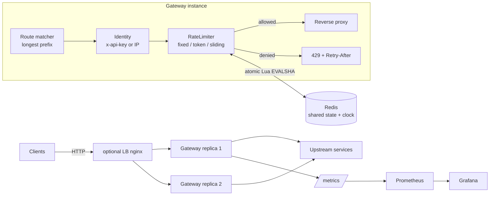

# Distributed Rate Limiter & API Gateway

<!-- badges -->
[](https://github.com/Urthella/distributed-rate-limiter)
[](https://github.com/Urthella/distributed-rate-limiter/commits/main)


A reverse-proxying API gateway with pluggable rate-limiting algorithms and pluggable state stores, built in Node.js + TypeScript.

- **Three algorithms** behind one `RateLimiter` interface: **Fixed Window Counter**, **Token Bucket** (refill rate + burst capacity, fractional refill), **Sliding Window Log**.
- **Two stores per algorithm**: in-memory (zero dependencies, single instance) and **Redis with atomic Lua scripts** (`EVALSHA` with `EVAL` fallback) for correct *distributed* limiting across many gateway replicas.
- **Gateway**: longest-prefix route matching, hand-rolled robust reverse proxy (method/headers/body preserved, hop-by-hop headers stripped, `X-Forwarded-*` added, upstream failures → `502`), per-route algorithm + limits, per-API-key overrides.
- **Proper 429s**: `Retry-After`, `X-RateLimit-Limit`, `X-RateLimit-Remaining`, `X-RateLimit-Reset` on every limited route.
- **Observability**: Prometheus metrics at `/metrics` (request counts by route/status, 429 counts by route/algorithm, latency histogram, upstream errors) + a ready-to-import Grafana dashboard.
- **Runs with zero external services** — a demo upstream and a plain-Node load generator are bundled. Docker/Redis/Prometheus/Grafana are strictly optional.

---

## Architecture



Plain-text version:

```
clients ──> [optional nginx LB] ──> gateway replica(s)
                                        │
                     ┌──────────────────┼─────────────────────┐
                     │ 1. match route (longest path prefix)    │
                     │ 2. identity: x-api-key header, else IP  │
                     │ 3. RateLimiter.check(key)  ── memory    │
                     │        │                   └─ or Redis (atomic Lua)
                     │ 4a. allowed -> reverse proxy to upstream│
                     │ 4b. denied  -> 429 + Retry-After        │
                     └──────────────────┬─────────────────────┘
                                        └──> /metrics (Prometheus) -> Grafana
```

Code map (all under `src/`):

| File | Responsibility |
|---|---|
| `index.ts` | CLI entry: load config, start gateway, graceful shutdown |
| `gateway.ts` | HTTP server, routing, identity, limiter dispatch, 429s, metrics |
| `proxy.ts` | Hand-rolled reverse proxy (streams body, strips hop-by-hop, 502 on failure) |
| `config.ts` | JSON config loader + strict validation |
| `identity.ts` | Client key: `x-api-key` header if present, else IP |
| `metrics.ts` | prom-client registry + counters/histogram |
| `limiters/factory.ts` | Algorithm × store selection (env `REDIS_URL` ⇒ Redis, else memory) |
| `limiters/memory/*` | The three algorithms, in-process state |
| `limiters/redis/*` | The three algorithms as atomic Lua scripts + `EVALSHA`/`EVAL` runner |
| `demo-upstream.ts` | Tiny echo server so the demo needs no external services |

---

## Quick start (zero dependencies beyond Node)

```bash
npm install
npm run demo     # builds, starts demo upstream + gateway, runs the load generator, tears down
```

You should see a table with both `2xx` and `429` counts per route/key, sample
`X-RateLimit-*` headers, and a `/metrics` preview.

Run pieces manually:

```bash
npm run build
node dist/demo-upstream.js          # terminal 1 (port 9100)
node dist/index.js                  # terminal 2 (port 8080, config/gateway.json)

curl -i http://127.0.0.1:8080/api/fixed/hello -H "x-api-key: me"
# HTTP/1.1 200 ... X-RateLimit-Limit: 10, X-RateLimit-Remaining: 9, X-RateLimit-Reset: <epoch s>
# repeat 10+ times quickly -> HTTP/1.1 429 + Retry-After
```

Tests:

```bash
npm test         # vitest: algorithm units (fake timers), Lua wrappers (stubbed eval), gateway integration
```

Redis-backed integration tests are **skipped unless `REDIS_URL` is set**:

```bash
REDIS_URL=redis://127.0.0.1:6379 npm test
```

---

## Configuration

`config/gateway.json` (selected via `CONFIG_PATH`, port via `PORT`):

```jsonc
{
  "listen": { "port": 8080 },
  "trustProxy": false,              // trust X-Forwarded-For for IP identity (only behind a trusted LB)
  "routes": [
    {
      "id": "fixed",                       // metrics label (defaults to pathPrefix)
      "pathPrefix": "/api/fixed",          // longest prefix wins; segment-boundary safe
      "upstream": "http://127.0.0.1:9100", // http(s) base URL
      "stripPrefix": true,                 // "/api/fixed/x" -> "/x" upstream
      "timeoutMs": 10000,                  // upstream timeout (default 10s)
      "rateLimit": { "algorithm": "fixed-window", "limit": 10, "windowSeconds": 10 },
      "keyOverrides": { "premium-key": { "limit": 100 } }   // per-API-key overrides
    },
    { "pathPrefix": "/api/token",   "upstream": "...", "rateLimit": { "algorithm": "token-bucket", "capacity": 8, "refillPerSecond": 2 } },
    { "pathPrefix": "/api/sliding", "upstream": "...", "rateLimit": { "algorithm": "sliding-window-log", "limit": 10, "windowSeconds": 10 } }
  ]
}
```

**Client identity**: requests are keyed by the `x-api-key` header when present, otherwise by client IP. Every key gets independent counters; `keyOverrides` lets specific API keys have bigger (or smaller) allowances.

**Store selection**: set `REDIS_URL` and every limiter transparently switches from in-memory maps to shared Redis state. Nothing else changes.

**Environment** (see `.env.example`): `PORT`, `CONFIG_PATH`, `REDIS_URL`, `UPSTREAM_PORT`.

---

## Rate-limit responses

Allowed and denied responses both carry:

| Header | Meaning |
|---|---|
| `X-RateLimit-Limit` | Window limit (or bucket capacity for token bucket) |
| `X-RateLimit-Remaining` | Requests still available right now |
| `X-RateLimit-Reset` | Unix epoch **seconds** when the allowance fully resets |

Denied requests get status **429** plus `Retry-After: <seconds>` and a JSON body
`{"error":"rate_limited","message":"Too many requests","retryAfterSeconds":N}`.

---

## Algorithm comparison

| | Fixed Window Counter | Token Bucket | Sliding Window Log |
|---|---|---|---|
| **Accuracy** | Coarse — counts reset at window edges | Enforces *average* rate exactly; burst-tolerant by design | Exact over any trailing window |
| **Memory / key** | O(1) — one counter | O(1) — two numbers (tokens, timestamp) | O(limit) — one timestamp per allowed request |
| **Burst behavior** | Up to **2× limit** across a window boundary (spend the end of window N and the start of N+1) | Bursts allowed up to `capacity`, then smoothed to `refillPerSecond` | No boundary artifact; a burst simply fills the window |
| **Cost / check (Redis)** | 1 `INCR` (+`PEXPIRE` once) | small hash read+write | `ZREMRANGEBYSCORE`+`ZCARD`+`ZADD` |
| **Good for** | Cheap coarse quotas, high-cardinality keys | Public APIs wanting burst UX with a sustained cap | Strict SLAs, paid quotas, small limits |
| **Weakness** | Boundary burst (documented, demonstrated in tests) | "Remaining" is a floor of fractional tokens; less intuitive reset semantics | Memory grows with limit; hot keys cost more per check |

Implementation notes:

- **Token bucket refill is fractional** — `refillPerSecond: 0.5` (one request per 2s) works, and 500 ms at 1 token/s accrues exactly 0.5 tokens (covered by tests).
- **Sliding window log prunes expired entries on every check** and only records *allowed* requests, so a rejected flood cannot extend a client's own penalty, and per-key memory is bounded by `limit`.
- **Fixed window boundary weakness**: with `limit=10/10s`, a client can send 10 requests at t=9.9s and 10 more at t=10.1s — 20 within 200 ms — because the counter resets at t=10s. The sliding window log on the same config would allow exactly 10 in any 10-second span. This is the classic accuracy/memory trade-off; pick per route.

---

## The distributed-state problem (and why atomic Lua fixes it)

**Naive approach**: each gateway instance keeps in-memory counters. With N replicas behind a load balancer, a client's requests are spread across replicas, each of which sees only ~1/N of the traffic — so the client effectively gets **N× the configured limit**. Sticky sessions only paper over this (failover, rebalancing, multiple LBs all break it).

**Shared store, still broken**: moving counters to Redis with `GET` → compute → `SET` from the gateway reintroduces the bug as a race: two replicas both read `count=9` (limit 10), both conclude "allowed", both write — 11 requests pass. Read-modify-write over the network is not atomic.

**The fix**: run the entire check-and-update as a **Lua script inside Redis**. Redis executes scripts single-threaded and atomically — no other command interleaves. One round-trip does read + decide + write as an indivisible unit, so the limit holds exactly no matter how many gateway replicas hammer the same key concurrently. The scripts live in [`src/limiters/redis/scripts.ts`](src/limiters/redis/scripts.ts).

Scripts are invoked by SHA (`EVALSHA`) to avoid resending the source each call; on `NOSCRIPT` (first use, Redis restart, `SCRIPT FLUSH`) the client transparently falls back to `EVAL`, which also loads the script ([`runScript.ts`](src/limiters/redis/runScript.ts)).

## Clock drift and time edge cases

- **Multi-instance clock drift doesn't matter**: the Lua scripts take *all* timestamps from `redis.call('TIME')` — the Redis server's clock — never from the gateway host. If replica A's clock is 3 s ahead of replica B's, their limiting decisions are still identical because neither clock is consulted. One store, one clock. (Scripts that call `TIME` and then write rely on effect-based replication, the default since Redis 5.)
- **In-memory mode** uses the local `Date.now()` — fine by construction, since memory state is only ever consulted by the one process that owns it.
- **Token bucket** stores fractional tokens and a last-refill timestamp; elapsed time is clamped at ≥ 0 so a backwards clock step (NTP) can never mint tokens.
- **Sliding window log** prunes strictly by score against server time; entries also carry a TTL (`PEXPIRE window+1s`) so abandoned keys expire on their own.
- **Fixed window** keys are suffixed with the window id (`key:176722560`) and TTL'd, so stale windows self-clean; the boundary-burst weakness is documented above.

---

## Observability

`GET /metrics` (Prometheus text format, per instance):

| Metric | Labels | Meaning |
|---|---|---|
| `gateway_http_requests_total` | `route, method, status` | All handled requests |
| `gateway_rate_limited_total` | `route, algorithm` | 429s issued |
| `gateway_http_request_duration_seconds` | `route, method, status` | Latency histogram |
| `gateway_upstream_errors_total` | `route` | Proxy failures (502) |

plus prom-client's default Node process metrics.

### Grafana dashboard

Ready-to-import JSON: [`deploy/grafana/dashboards/gateway-dashboard.json`](deploy/grafana/dashboards/gateway-dashboard.json)
(requests/s by route, 429/s by route+algorithm, p50/p95/p99 latency, status breakdown, error stats).

Import: Grafana → **Dashboards → New → Import** → upload the JSON → pick your Prometheus datasource. In the docker-compose stack below it is **auto-provisioned** — open Grafana and it's already there.


*(screenshot placeholder — run the docker-compose stack and capture the provisioned "API Gateway & Rate Limiter" dashboard)*

---

## Load testing

**Bundled, zero-install** (used by `npm run demo`):

```bash
node scripts/loadgen.mjs                      # GATEWAY_URL, LOADGEN_REQUESTS, LOADGEN_CONCURRENCY env vars
```

Prints allowed vs 429 per route per API key plus observed headers.

**k6** (if installed — https://k6.io):

```bash
k6 run scripts/loadtest.js
k6 run -e GATEWAY_URL=http://localhost:8080 scripts/loadtest.js
```

10 VUs × 30 s across all three routes, one API key per VU; checks that every response is `200|429`, carries rate-limit headers, and that 429s carry `Retry-After`.

---

## Optional: multi-instance mode with Docker

> Requires Docker — **not** needed for anything above.

```bash
docker compose up --build
```

Brings up: **Redis** + **2 gateway replicas** (both `REDIS_URL=redis://redis:6379`) + **nginx LB** on `:8080` + the demo upstream + **Prometheus** (`:9090`) + **Grafana** (`:3000`, admin/admin, dashboard pre-provisioned).

Prove the distributed correctness claim:

```bash
GATEWAY_URL=http://localhost:8080 node scripts/loadgen.mjs
```

Traffic round-robins across both replicas, yet each API key still gets exactly one limit — the counters live in Redis and every check is one atomic Lua execution. Rerun the same stack with `REDIS_URL` removed from `docker-compose.yml` and you will see roughly **double** the allowed requests: that is the naive per-instance failure mode this project exists to solve.

---

## Testing strategy

| Layer | File(s) | Approach |
|---|---|---|
| Algorithms (memory) | `test/fixedWindow.test.ts`, `tokenBucket.test.ts`, `slidingWindowLog.test.ts` | vitest fake timers; asserts limits, window rollover, fractional refill, pruning, exact header values |
| Redis wrappers + protocol | `test/redisLimiters.test.ts` + `test/helpers/fakeRedis.ts` | In-process fake of `EVAL`/`EVALSHA` that mirrors each Lua script's state model and enforces real `NOSCRIPT` semantics — exercises the fallback path, argument passing, result parsing |
| Redis for real | `test/redisIntegration.test.ts` | Runs the actual Lua scripts against a live server; **auto-skipped without `REDIS_URL`** |
| Gateway end-to-end | `test/gateway.test.ts` | Boots demo upstream + gateway on ephemeral ports; asserts proxying fidelity, 200→429 transitions, header correctness, per-key isolation, key overrides, 404/502, `/metrics` content |

---

## Trade-offs & production notes

- **Fail-open**: if the Redis backend errors mid-request, the gateway logs and lets the request through rather than turning a Redis blip into a full outage. For strict quota enforcement (billing), flip this to fail-closed — the trade-off is availability vs. strictness.
- **One extra RTT per request** in Redis mode. Mitigations not implemented here: local token caches with periodic sync (sacrifices exactness), pipelining, running limiters only at the edge tier.
- **Hot keys**: a single very hot client key serializes on one Redis shard. Sliding-window-log is the most expensive per check; prefer token bucket for hot paths.
- **Redis Cluster**: keys would need hash tags (`{client}`) if you shard; this project targets a single Redis.
- **Sliding window log records only allowed requests** — an attacker spamming 429s doesn't push their own reset time out, but it also means "10 allowed per window" rather than "10 attempts per window". Both semantics are defensible; changing it is a two-line edit in the Lua.
- **Identity is trust-based**: `x-api-key` is taken at face value (no auth), and IP identity behind a proxy requires `trustProxy` plus a trustworthy LB. Real deployments should authenticate keys before rate-limiting on them.
- **No request buffering**: bodies stream through the proxy, so large uploads don't inflate gateway memory; the flip side is that a request already streaming can't be retried against a second upstream.

---

## Related projects

Part of my backend and distributed-systems series:

- [**realtime-collab-editor**](https://github.com/Urthella/realtime-collab-editor): CRDT sync over WebSockets, live presence, debounced persistence
- [**rag-codebase-qa**](https://github.com/Urthella/rag-codebase-qa): AST-aware chunking, hybrid BM25 + vector retrieval, cited answers
- [**event-driven-order-system**](https://github.com/Urthella/event-driven-order-system): saga orchestration, compensating transactions, idempotent consumers, tracing
- [**job-queue-orchestrator**](https://github.com/Urthella/job-queue-orchestrator): race-safe job claiming, retries with backoff, dead-letter queue, DAG workflows

More of my work: [github.com/Urthella](https://github.com/Urthella) · [utkudemirtas.tech](https://www.utkudemirtas.tech)
